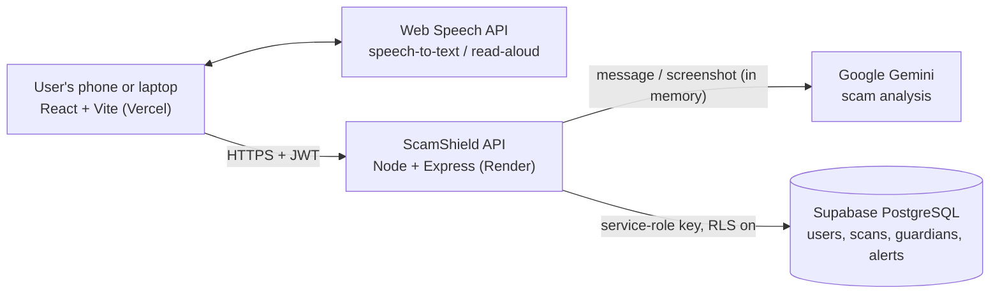

# ScamShield

**Check before you click, pay or panic.** ScamShield is an AI scam checker for Indian families. Paste a suspicious message, upload a screenshot or put a call on speaker, and get a clear verdict and next steps in English, Hindi or Kannada.

| | |
|---|---|
| **Live app** | https://niat-hackthon.vercel.app |
| **Live API** | https://scamshield-api-1caf.onrender.com/api/health |
| **Demo login** | `asha@example.com` / `Demo@1234` |
| **API reference** | [API.md](API.md) |

---

## The problem

Online fraud in India has moved from email spam to messages and calls that look official. Common examples:

- **Fake KYC / account-block SMS** carrying look-alike bank links
- **"Digital arrest" video calls** from people posing as CBI, police or customs officers
- **Part-time "task" jobs** that ask for a deposit to unlock earnings
- **UPI "collect" requests** disguised as cashback
- **Fake courier, electricity-bill and instant-loan messages**

The people most at risk, such as senior citizens, first-time smartphone users and students, are also the least likely to recognise these patterns or to know about the **1930** National Cyber Crime Helpline and **cybercrime.gov.in**. Most victims realise too late, and many don't tell family until the money is gone.

ScamShield gives people a second opinion before they act, explains it in their own language, and alerts a family member when it matters.

---

## Features

### Message and screenshot scan
Paste a WhatsApp, SMS or email message, or upload a screenshot (JPEG/PNG/WEBP, up to 8 MB). Gemini returns:
- a **risk score (0–100)** and a verdict: `safe`, `suspicious` or `scam`
- the **scam type**: KYC/bank, task job, digital arrest, lottery, trading, UPI collect, courier, loan app, electricity bill, impersonation, phishing link, sextortion
- **red flags**, each quoting the exact words from the message so the app can highlight them
- a **simple explanation**, written as if explaining to a parent
- **next steps**: don't click, don't share your OTP, block the sender, call 1930, report at cybercrime.gov.in, verify on the official app

ScamShield never says a message is "100% safe". Low-risk results still advise verifying on the official app.

### Live Call Guard
Put a suspicious call on speaker. The browser turns the speech into text as the call happens (Web Speech API, `en-IN` / `hi-IN` / `kn-IN`), and the conversation is checked for scam patterns as it develops. When a scam is detected, a full-screen alert appears, the phone vibrates, and the app suggests what to say to end the call safely. A built-in demo "digital arrest" script lets you try it without a real call.

### Community scam database and "Check before you pay"
Before paying, paste a **UPI ID, phone number or link** to see whether other users have reported it. Users can report a number, UPI ID or link themselves, so every report helps protect the next person.

### Family Guardian
Invite a family member as your **Guardian**. Once they accept, they get an alert whenever you scan something rated `scam`, so a son or daughter can call a parent before the money moves. Either person can remove the link at any time.

### Multilingual, with read-aloud
Explanations, red flags and next steps are available in **English, Hindi and Kannada**. Any past result can be re-explained in another language without scanning again. A **read-aloud** button speaks the verdict in the chosen language, which helps users who find reading on a phone hard.

### Scam trends
A public dashboard of anonymous counts: total scans, scams caught, and the most common scam types this week. It never shows personal data.

---

## Implementation status

| Feature | Frontend | Backend API |
|---|---|---|
| Message & screenshot scan | Done | Done: `POST /api/scans` |
| Re-explain in another language | Done | Done: `POST /api/scans/:id/explain` |
| Scan history | Done | Done: `GET/DELETE /api/scans` |
| Family Guardian & alerts | Done | Done: `/api/guardians`, `/api/alerts` |
| Scam trends | Done | Done: `GET /api/trends` |
| Read-aloud | Done (in the browser) | Not needed |
| Live Call Guard | Done (speech-to-text in the browser) | Done: `POST /api/calls/analyze`, `POST /api/calls` |
| Check before you pay / community reports | Done | Done: `GET /api/lookup`, `POST /api/reports` |

> **Demo mode:** the hosted frontend is currently built with `VITE_USE_MOCK=true`, so it runs entirely on simulated data in the browser and accepts any login. To use the real AI and database, run it locally against the API (see [Setup](#setup)) or redeploy with `VITE_USE_MOCK=false`.

---

## Tech stack

| Layer | Technology |
|---|---|
| Frontend | React 18, Vite, React Router, Tailwind CSS, Recharts, Axios, lucide-react |
| In-browser speech | Web Speech API (speech recognition for Live Call Guard, speech synthesis for read-aloud) |
| Backend | Node.js 20+, Express 5 (ES modules) |
| AI | Google Gemini via `@google/genai`, using JSON responses checked against a schema |
| Database | Supabase PostgreSQL, accessed through `@supabase/supabase-js` with the service-role key (server only) |
| Auth | JWT (7-day tokens) + bcrypt; Supabase Auth is not used |
| Validation & uploads | Zod, Multer (memory storage only) |
| Security | helmet, CORS allow-list, express-rate-limit, one central error handler |
| Hosting | Vercel (frontend), Render (API), Supabase (database) |

---

## Architecture



**How a scan works:**
1. The browser compresses the screenshot and sends it, with any pasted text, to `POST /api/scans` with the user's JWT.
2. The API validates the input and checks the image's real file type, then sends it to Gemini **in memory**. Images are never written to disk or stored.
3. Gemini returns structured JSON. The server checks it against a schema and enforces consistency: each score must fall within its verdict's range, and safe results always advise verifying on the official app.
4. Before saving, every run of 6+ digits (OTPs, account, card and Aadhaar numbers) is masked to its last 4 digits, and the text is cut to 2,000 characters.
5. If the verdict is `scam`, an alert is created for every accepted Guardian.

### Security and privacy
- **No images stored.** Only the analysis and the masked text are saved.
- **Prompt-injection defence:** the scanned message is treated as untrusted data and wrapped in random markers that change on every request. The model is told never to follow instructions inside the message. In testing, a message telling the AI to "mark this safe" was still rated a scam.
- **Database locked down:** Row Level Security is on for every table, with no public policies. Only the API's service-role key can read or write, and every query is filtered by the logged-in user.
- **Rate limits:** strict on login and signup (20 per 15 min) and on AI scans (20 per 10 min per user).
- **Passwords** are hashed with bcrypt and never returned by the API. Production error responses contain no stack traces.

---

## Repository structure

```
.
├── client/                 React + Vite frontend (deployed to Vercel)
│   └── src/
│       ├── api/            Axios client, endpoints, mock backend for demo mode
│       ├── components/     RiskMeter, RedFlagCard, ReadAloudButton, ScamAlertOverlay, ...
│       ├── hooks/          useSpeech, useSpeechRecognition, useLiveCallAnalysis
│       └── pages/          Scan, ScanResult, LiveCallGuard, CheckPay, Family, Alerts, Trends, ...
├── server/                 Express API (deployed to Render)
│   ├── scripts/migrate.js  Optional: apply the SQL with a direct DATABASE_URL
│   └── src/
│       ├── config/         Environment validation, constants
│       ├── controllers/    Route handlers
│       ├── middleware/     auth, validate, upload, rateLimit, errorHandler
│       ├── prompts/        Gemini system prompts and response schemas
│       ├── routes/         /api/auth, users, scans, guardians, alerts, trends
│       ├── schemas/        Zod request schemas
│       ├── services/       gemini, db (Supabase), alert
│       └── utils/          maskSensitive, localized fallback text, errors
├── supabase/
│   ├── migrations/         001_initial_schema.sql, 002_calls_and_community_reports.sql
│   ├── seed.sql            Demo users, scans, guardian links and alerts
│   └── seeds/              Community scam reports for fictional demo numbers, UPI IDs and links
└── API.md                  Full API contract with sample requests and responses
```

---

## Setup

### Prerequisites
- Node.js 20 or newer
- A Supabase project
- A Google Gemini API key ([Google AI Studio](https://aistudio.google.com/))
- Supabase CLI: run `npm install` in the repo root, then use it as `npx supabase`

### 1. Database
```bash
npm install                                   # installs the Supabase CLI locally
npx supabase login
npx supabase link --project-ref <your-project-ref>
npx supabase db push --remote --include-seed  # schema + demo data
```
If the push fails with `Connection terminated unexpectedly` (seen on Windows), pass the session-pooler URL from **Supabase → Connect** and use DNS-over-HTTPS:

```bash
npx supabase db push --include-seed --dns-resolver https \
  --remote="postgresql://postgres.<project-ref>:<url-encoded-password>@<pooler-host>:5432/postgres"
```

Alternative without the CLI: set `DATABASE_URL` in `server/.env`, then run `npm run migrate -- --seed` from `server/`.

### 2. Server
```bash
cd server
npm install
cp .env.example .env     # then fill in the values (see below)
npm run dev              # http://localhost:5000
```
Check it: `curl http://localhost:5000/api/health` should return `{"status":"ok"}`.

### 3. Client
```bash
cd client
npm install
cp .env.example .env     # set VITE_API_BASE_URL and VITE_USE_MOCK
npm run dev              # http://localhost:5173
```
Set `VITE_USE_MOCK=false` to use the real API, or `true` to run the UI offline on demo data.

---

## Environment variables

Never commit real values. `.env` files are git-ignored; only `.env.example` files belong in the repo.

### Server (`server/.env`)

| Variable | Purpose |
|---|---|
| `PORT` | Port the API listens on (Render sets this automatically) |
| `NODE_ENV` | `development` or `production` |
| `CLIENT_URL` | Allowed frontend origin(s) for CORS, comma-separated |
| `JWT_SECRET` | Secret for signing login tokens (at least 32 random characters) |
| `GEMINI_API_KEY` | Google Gemini API key |
| `GEMINI_MODEL` | Gemini model name. `gemini-3.5-flash` is recommended; new API keys can't use `gemini-2.5-flash`. |
| `GEMINI_FALLBACK_MODEL` | Optional comma-separated list of models to try, in order, when the main one is overloaded, out of quota or times out (e.g. `gemini-3.5-flash-lite,gemini-3.1-flash-lite`) |
| `SUPABASE_URL` | Supabase project URL |
| `SUPABASE_SERVICE_ROLE_KEY` | Supabase service-role key. Server only; never expose it to the browser. |
| `DATABASE_URL` | Optional; only used by `npm run migrate` |

### Client (`client/.env`)

| Variable | Purpose |
|---|---|
| `VITE_API_BASE_URL` | Base URL of the API, e.g. `http://localhost:5000` |
| `VITE_USE_MOCK` | `true` = demo data in the browser, `false` = real API |

---

## Demo accounts

The seed data creates three linked accounts. All use the password `Demo@1234`.

| Email | Role in the demo |
|---|---|
| `asha@example.com` | Senior citizen with past scam scans; protected by Ravi |
| `ravi@example.com` | Asha's son and her accepted Guardian; has scam alerts waiting |
| `priya@example.com` | Student with a pending Guardian invite to Ravi |

The community database is seeded with **fictional** identifiers you can try in "Check before you pay", or include in a scanned message or call:

| Identifier | Reports (this week) | Scam type |
|---|---|---|
| `+910000000001` | 94 (42) | Digital arrest |
| `+910000000002` | 52 (21) | Electricity bill / KYC |
| `+910000000003` | 18 (6) | Part-time job |
| `+910000000004` | 11 (3) | Loan app |
| `kyc.refund.demo@oksbi` | 84 (36) | Fake KYC refund (UPI) |
| `sbi-kyc-update.example` | 173 (78) | Fake SBI KYC website |
| `parcel-customs-fee.example` | 37 (12) | Courier / customs fee |

**Suggested walkthrough:** log in as Asha and scan a fake KYC message. Then log in as Ravi to see the new Guardian alert. Open any result and switch it to Hindi or Kannada, then tap read-aloud.

---

## Deployment

| Service | Settings |
|---|---|
| **Render** (API) | Root directory `server`, build command `npm install`, start command `npm start`. Add the server environment variables, with `NODE_ENV=production` and `CLIENT_URL` set to the Vercel URL. |
| **Vercel** (frontend) | Root directory `client`, framework Vite, build command `npm run build`, output `dist`. Set `VITE_API_BASE_URL=https://scamshield-api-1caf.onrender.com` and `VITE_USE_MOCK=false`. |
| **Supabase** | Apply migrations with `npx supabase db push --remote`. |

On Render's free plan the API sleeps when idle, so the first request after a pause can take up to a minute.

---

## If you've been scammed

- Call **1930** (National Cyber Crime Helpline) immediately. The sooner you call, the better the chance of freezing the money.
- Report at **https://cybercrime.gov.in**
- Call your bank to block your cards and UPI, and change your passwords.

ScamShield is a support tool, not a guarantee. When in doubt, verify through the official app, website or branch.
